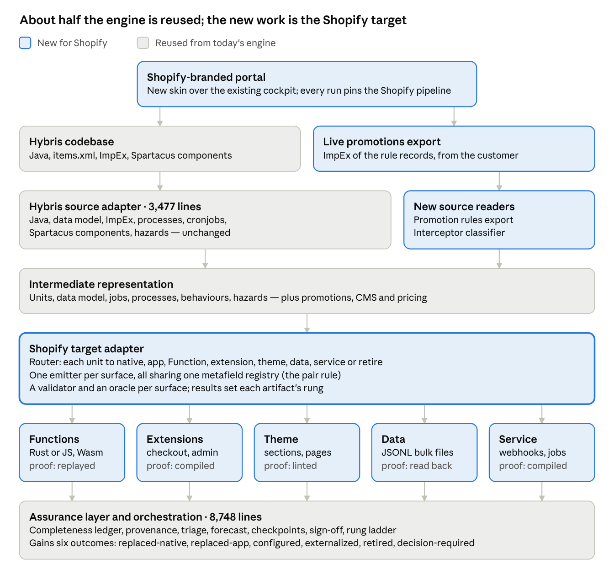
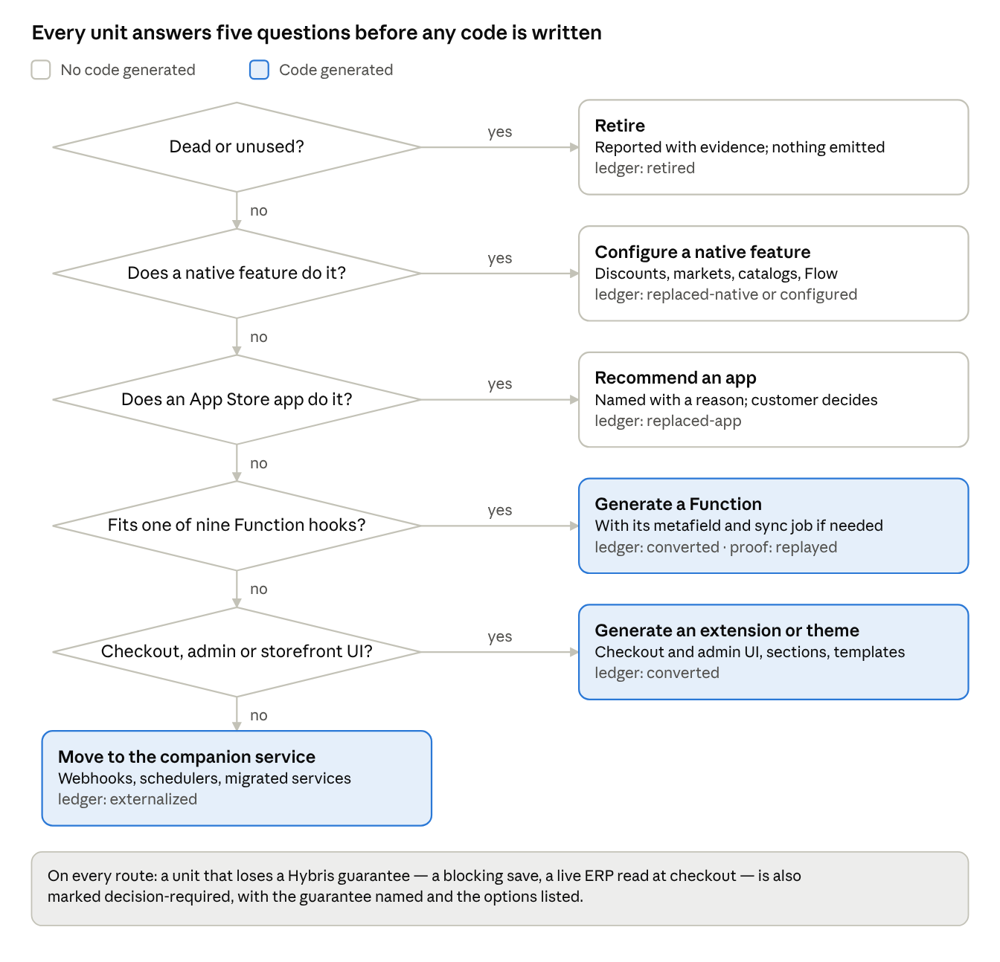
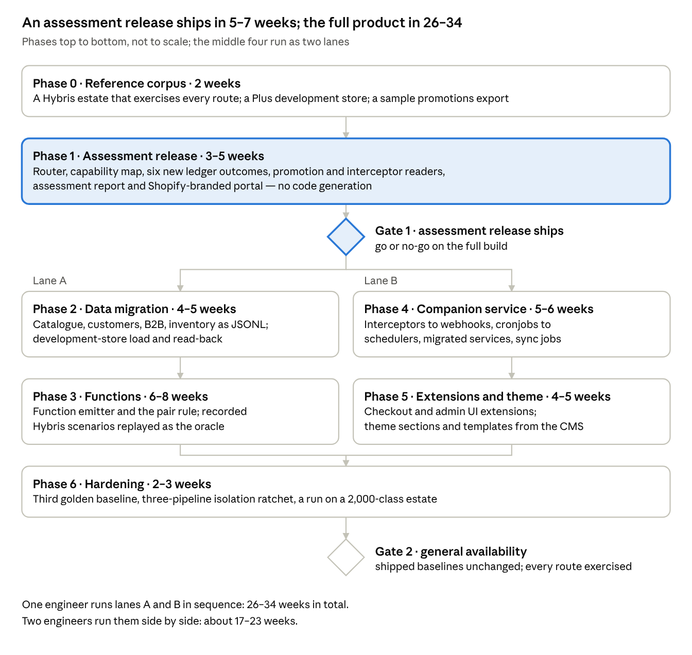

# SAP Hybris → Shopify Migration Portal — Feasibility & Technical Design

**Date:** 2026-11-11 · **Status:** for stakeholder review · **Plain-English version:** [SHOPIFY_BRIEF.md](SHOPIFY_BRIEF.md) and [SHOPIFY_DECK.pptx](SHOPIFY_DECK.pptx)

## Executive summary

**Yes, a Hybris → Shopify migration portal is feasible on our existing architecture — but it is a different product from the two we ship.** Our current pipelines convert code into code. Shopify will not run most Hybris code, so this portal's core job is to decide where every Hybris capability goes, generate the minority that becomes code, and prove each decision.

- **What it can deliver:** a full inventory of a Hybris estate with a destination and evidence for every capability; generated Shopify Functions, checkout and admin extensions, bulk-load data files, theme scaffolding and an external companion service; and a sign-off that states what was proven, what was configured, and what a person must decide.
- **What it cannot honestly claim:** "100% converted". Of 28 Hybris subsystems, 6 land as generated code inside Shopify; 15 become native settings, data, apps, or nothing. Blocking validation on admin saves has no Shopify equivalent at all.
- **What we reuse:** about 47% of today's 26,096-line engine runs unchanged — the assurance layer, orchestration and agents (8,748 lines) and the Hybris source adapter (3,477 lines). The Shopify target is new and larger than either existing target, because it emits to eight surfaces instead of one.
- **Why now:** SAP Commerce 2205, the last on-premises release, left mainstream maintenance on July 31, 2026. Shopify Scripts stopped running on June 30, 2026, making Functions the only checkout-logic target — a stable, well-documented surface to aim at.
- **Unusual strength:** unlike SAP Commerce, Shopify gives us a free verification target. Development stores and a local Function runner let generated logic be executed against recorded Hybris scenarios, not just compiled.

**Recommendation:** build it as a third pipeline on the existing engine with its own Shopify-branded portal, not as a separate codebase from scratch. Ship an **assessment-only** release first: it needs no code generation, answers the question every Hybris customer asks in discovery, and is sellable on its own. Estimated 26–34 engineer-weeks for the full product with one engineer, about 17–23 with two — calibrated against our own roadmap's estimates, not measured.

**Decision needed first:** our multi-platform roadmap (v0.2, August 2026) locked scope to two pipelines — "no third platform". Building this reverses that decision and should be made explicitly.

## Why this is a different kind of migration

The two migrations we ship move code to code; Hybris → Shopify moves code to a platform that will not run most of it. That single fact reshapes the planner, the target adapter, the ledger and the verification story.

|  | Hybris → Salesforce (shipped) | Adobe → Hybris (shipped) | Hybris → Shopify (proposed) |
| --- | --- | --- | --- |
| Target runs arbitrary server code | Yes — Apex | Yes — Java in an extension | **No** — only sandboxed WebAssembly Functions at fixed checkout hooks |
| Where custom logic lands | One place: Apex classes | One place: a Hybris extension | **Eight or more places**: Functions, checkout UI extensions, theme, Hydrogen, Flow, metaobjects, native settings, an external app |
| Typical share of source that becomes code | Most of it | Most of it | **A minority** — most is replaced by native features, configured, moved to an app, or retired |
| Can a synchronous write hook be preserved | Yes — triggers | Yes — interceptors | **Mostly no** — Admin changes surface as webhooks, after the fact |
| Free verification target | Salesforce dev org | No — needs an SAP licence | **Yes** — free development stores and a local Function runner |

Three consequences follow, and the rest of this document is built on them.

1. **The planner becomes the product.** Today it decides *what kind of Apex* a unit becomes. For Shopify its first decision is *whether a unit becomes code at all*: replace with a native feature, install an app, configure a setting, generate a Function, generate an extension, move to an external service, or retire.
2. **The output is a multi-surface package, not a codebase.** One run emits a Shopify app (Functions + extensions), theme or storefront code, data files for bulk import, configuration as code, and an external companion service — each with its own layout and its own check.
3. **The completeness ledger needs new honest outcomes.** "Converted" is the wrong word for a promotion engine that becomes four native discounts. Outcomes such as `replaced-by-native`, `replaced-by-app`, `configured`, `externalized` and `retired` must be first-class, or the ledger will report a thin migration as complete — the success-shaped failure this product exists to prevent.

## Shopify as a target, verified November 2026

Shopify runs custom server logic only as sandboxed WebAssembly at nine checkout hooks, and since June 30, 2026 there is no other in-platform path. Everything else a Hybris estate does must become a native feature, an extension, data, or an external service. Each figure below was checked against Shopify's own documentation unless marked otherwise.

| Platform fact | What it means for this migration |
| --- | --- |
| **Nine Function APIs:** Cart Transform, Discount, Fulfillment Constraints, Order Routing, Pickup Point and Local Pickup Delivery Option Generators, Delivery Customization, Payment Customization, Cart and Checkout Validation ([Function APIs](https://shopify.dev/docs/api/functions/latest)) | The only place generated business logic can run inside Shopify. A Hybris service that is not one of these nine shapes cannot become a Function. |
| **Function limits:** 256 KiB binary, 10 MiB memory, 11 million instructions, 128 kB input, 40 kB output (carts up to 200 lines); input query ≤ 3,000 bytes and cost ≤ 30; metafield values over 10,000 bytes are not returned ([resource limits](https://shopify.dev/docs/api/functions/latest)) | Generated Functions must be Rust or tight JavaScript. Large Hybris price tables or rule sets cannot be read at runtime; they must be pre-computed into small metafields. |
| **No network calls** from Functions except a fetch target for custom apps on Enterprise stores, not available on development stores ([Function APIs](https://shopify.dev/docs/api/functions/latest)) | Hybris logic that calls an ERP at checkout (live pricing, credit checks, ATP) cannot move into a Function. It needs a pre-sync to metafields or an external service. |
| **Custom apps containing Functions require Shopify Plus**; public App Store apps work on all plans ([Function APIs](https://shopify.dev/docs/api/functions/latest)) | The migrated estate's Functions ship as a custom app, so the destination store must be Plus. |
| **Checkout UI extensions** on the information, shipping and payment steps are Plus-only; bundles are capped at 64 KB ([Checkout UI extensions](https://shopify.dev/docs/api/checkout-ui-extensions)) | Hybris checkout-step customisations become Preact extensions, again on Plus. |
| **Shopify Scripts:** no edits after April 15, 2026; stopped executing June 30, 2026 ([changelog](https://shopify.dev/changelog/posts/shopify-scripts-will-be-deprecated-on-june-30-2026)) | Functions are the only checkout-logic target. No Ruby path exists to fall back on. |
| **Variants and options:** 2,048 variants per product for all merchants since October 15, 2025 ([changelog](https://shopify.dev/changelog/posts/the-product-variant-limit-is-now-2048-for-all-merchants.md)); a fourth option is refused with "Can only specify a maximum of 3 options" ([productOptionsCreate](https://shopify.dev/docs/api/admin-graphql/latest/mutations/productOptionsCreate)) | Hybris multi-level variant hierarchies (style → colour → size → fit) deeper than three dimensions must be split into several products or flattened. A modelling decision per product type, not a mapping. |
| **Admin GraphQL rate limits:** 100 points/s Standard, 200 Advanced, 1,000 Plus, 2,000 Commerce Components; one query ≤ 1,000 points ([rate limits](https://shopify.dev/docs/apps/build/apis/graphql-admin/rate-limits)) | Data load speed is set by the destination plan. A dev store runs at the lowest tier. |
| **REST Admin API** legacy since October 1, 2024; new public apps GraphQL-only since April 1, 2025 ([REST reference](https://shopify.dev/docs/api/admin-rest)) | All generated integration code targets GraphQL. |
| **Bulk import:** JSONL up to 100 MB per file; from API 2026-01, five concurrent bulk mutations per app per shop ([bulk imports](https://shopify.dev/docs/api/usage/bulk-operations/imports)); arrays capped at 250 items, and after 500,000 variants non-Plus stores may create 10,000 variants a day ([API limits](https://shopify.dev/docs/api/usage/limits)) | Catalogue and customer loads go through staged JSONL bulk operations, not per-record calls. |
| **Order history import:** `orderCreate` needs an offline token and `write_orders`; trial and development stores accept at most five new orders per minute ([orderCreate](https://shopify.dev/docs/api/admin-graphql/latest/mutations/orderCreate)) | One million historical orders cannot be rehearsed on a dev store. Order history needs a paid-plan rehearsal, or should be archived rather than migrated. |
| **Customer accounts:** legacy accounts deprecated February 26, 2026 and unavailable to new stores ([changelog](https://shopify.dev/changelog/legacy-customer-accounts-are-deprecated)); new accounts sign in with a one-time six-digit email code, no password ([help centre](https://help.shopify.com/en/manual/customers/customer-accounts/new-customer-accounts)) | Hybris password hashes do not need migrating — there is nothing to migrate them into. Customers carry over as profiles keyed by email. |
| **B2B:** since April 2, 2026 companies, payment terms, volume pricing and up to three catalogs are on all plans; unlimited catalogs, direct catalog assignment, partial payments and deposits stay Plus-only ([changelog](https://changelog.shopify.com/posts/key-b2b-features-now-available-on-non-plus-plans)) | Hybris B2B units, price groups and payment terms have native homes. Hybris approval workflows and budgets do not appear in this list — to be confirmed. |
| **Shopify Plus** from $2,300 a month on a three-year term, $2,500 on one year — third-party figures, not published by Shopify ([elogic](https://elogic.co/blog/shopify-plus-pricing-2026/)) | Every realistic Hybris destination is Plus, so this is the customer's floor cost, before apps. |

**Why customers are moving now:** SAP Commerce 2205 is the final on-premises release and reached end of mainstream maintenance on July 31, 2026, per a support vendor citing SAP ([Spinnaker Support](https://www.spinnakersupport.com/blog/2026/05/29/sap-commerce-on-premises-eomm-what-to-do-next/)). On-premises Hybris customers now face a forced re-platform, and Shopify partners are already selling Hybris migrations as a service ([Shero Commerce](https://sherocommerce.com/pages/hybris-to-shopify-migration), [Swanky](https://swankyagency.com/migration/sap-commerce-cloud-to-shopify)).

## Capability map: where each Hybris subsystem lands

Of 28 Hybris subsystems, 6 become generated code inside Shopify (Functions and extensions), 5 become generated code in an external service, and 2 become a rebuilt storefront. The other 15 become native settings, data, apps, or nothing. That ratio is why the planner, not the code generator, carries this product.

| Hybris subsystem | Shopify destination | Route | What changes or is lost |
| --- | --- | --- | --- |
| Product types and attributes (`items.xml`) | Products, metafield definitions; metaobjects for structured custom types | Data load | No type inheritance; related custom item types become metaobjects with references |
| Catalog versions (Staged / Online, catalog sync) | Draft and active product status; a separate staging store for preview | Native feature | No staged catalog. Sync jobs and catalog-version-aware queries are retired |
| Variant hierarchy (base product + variant types) | One product, up to 3 options and 2,048 variants | Data load | A fourth variant dimension forces a split into several products; decided per product type |
| Category tree and classification system | Collections (flat), navigation menus, classification attributes as metafields | Native feature | Hierarchy moves into menus; attribute inheritance down the tree is lost |
| Price rows, user price groups, quantity tiers | Markets price lists, B2B catalogs, volume pricing | Native feature | Date-ranged prices need a scheduled job (Flow or external) |
| Promotion engine (rule builder, coupons) | Native automatic and code discounts first; a Discount Function for what they cannot express | Native feature | Each rule is classified before anything is generated; priorities and stacking become discount combinations |
| Cart calculation strategies | Cart Transform and Discount Functions | Function | Bundles and line expansion map; arbitrary recalculation of the cart total does not |
| Delivery-mode and payment-mode strategies | Delivery Customization and Payment Customization Functions | Function | Functions hide, rename and reorder options; they cannot add a carrier |
| Cart and checkout validators | Cart and Checkout Validation Function | Function | Enforced at cart and checkout only, never on an admin edit |
| Checkout step customisations | Checkout UI extensions in Preact, 64 KB bundle, Plus only | Extension | The checkout's own layout and step order belong to Shopify |
| Model interceptors and event listeners | Webhooks into the external service; Flow | External service | **Synchronous becomes asynchronous: an admin save can no longer be blocked.** The largest semantic gap |
| Business processes (`*-process.xml`) | Native payment capture and fulfilment; Flow for side steps | Native feature | Wait states and custom actions move to Flow or the external service |
| Cronjobs | The external service's scheduler; Flow only for small jobs | External service | Flow schedules run at most every 10 minutes over lists of 100 items, too small for batch jobs |
| Order management: sourcing, warehousing, consignments | Locations, fulfilment orders, Order Routing and Fulfillment Constraints Functions | Function | Custom sourcing strategies become routing logic; consignments become fulfilment orders |
| Spring services whose logic fits none of the nine hooks | External companion service on the Admin GraphQL API | External service | Same logic, new home: reads and writes through a rate-limited API instead of `ModelService` |
| Customers and addresses | Customer profiles, bulk-imported | Data load | Passwords are not carried; customers sign in by email code |
| B2B units, customers, cost centres, budgets, approvals | Companies, locations, contacts, catalogs, payment terms | Native feature | Budgets and approval workflows have no confirmed native home |
| Order history | `orderCreate` with a past `processedAt`, or an archive | Data load | Five orders a minute on non-paid stores; large histories are usually archived |
| CMS pages, slots, components (SmartEdit) | Online Store 2.0 templates, sections, blocks; metaobjects | Theme / storefront | Component restrictions and personalisation are redesigned |
| Storefront (accelerator JSP or Spartacus Angular) | Liquid theme, or Hydrogen (React) | Theme / storefront | Rebuilt rather than translated; Angular to React is the closest code-to-code step |
| Solr search and merchandising | Shopify Search & Discovery app, or a third-party search app | Shopify app | Boost, bury and synonym rules are reconfigured, not migrated |
| Custom OCC REST endpoints | Storefront API, an app proxy, or the external service | External service | API contracts change; their clients change with them |
| Backoffice customisations | Admin UI extensions: actions, blocks, print actions | Extension | Admin screens are cards and modals inside Shopify's admin |
| Base sites, stores, languages, currencies | Markets, translations, expansion stores | Native feature |  |
| Stock levels and warehouses | Inventory quantities at locations | Data load | Reservation and ATP rules simplify to Shopify's model |
| ERP integration (Data Hub, IDocs, CPI) | Middleware or iPaaS | External service | Scaffolded and documented by the tool; built by the integration team |
| Tax strategies | Shopify Tax or a tax app | Shopify app |  |
| Dead code, unused add-ons, sample data | Nothing | Retire | Identified at discovery and reported, so retirement is a decision, not an omission |

The agencies already selling this migration do the same triage by hand in a two-to-four-week paid discovery: "each \[Java extension\] becomes a native Shopify feature, an app, a Shopify Function, or custom code" ([Shero Commerce](https://sherocommerce.com/pages/hybris-to-shopify-migration)). Automating that triage, with evidence per decision, is the product's core value.

## Challenges, ranked

Three challenges are hard in kind, not just in effort: blocking writes that Shopify cannot block, promotion rules stored as data, and Functions that cannot see live data. None stops the product; each changes what it can honestly claim.

| # | Challenge | Severity | Why it is hard | How the product handles it |
| --- | --- | --- | --- | --- |
| 1 | **Blocking writes become non-blocking** | High | Hybris interceptors veto a save synchronously. Shopify gives custom code no veto on admin or API writes — only webhooks, after the fact. Invariants such as "a B2B price may not drop below cost" silently stop being enforced | Every interceptor is detected and classified: enforce at checkout (Validation Function), correct after the fact (webhook), or turn into a process rule. Each is surfaced as a decision with its risk, never auto-converted |
| 2 | **Promotions live in data, not code** | High | Hybris promotions are rule records authored in Backoffice and stored in the database, then compiled for the rule engine; the Java holds the engine, not the rules. The codebase alone does not contain the live promotions. Stacking, priority and exclusivity semantics differ from Shopify's discount combinations | The run takes a second input: an ImpEx export of the live promotion rules, supplied by the customer. A new source reader parses it. Each rule is classified as native-expressible or Function-required, with combination conflicts reported. Rules that cannot be expressed either way are named, not dropped |
| 3 | **Functions cannot see live data** | High | No network calls (bar Enterprise custom apps), 128 kB input, metafields over 10,000 bytes not returned. Hybris checkout logic that queries the database or an ERP has no runtime source | The tool emits a **pair**: the Function, plus a sync job in the external service that pre-computes what it reads into small metafields. Generating one without the other is refused |
| 4 | **Data model mismatch** | Medium | Three options per product; no staged catalog; flat collections; no classification inheritance | Per-product-type modelling decisions, recorded and reported — the pattern the Adobe pipeline already uses for Magento data-model ambiguities |
| 5 | **One unit, many artifacts that must agree** | Medium | A pricing rule can yield a Function, a metafield definition, a sync job and a theme snippet. If the namespace and key differ between them, every file is valid and the feature silently does nothing | A cross-artifact consistency check, the same idea that found three defects on its first run when the Hybris emitter was assembled |
| 6 | **Behavioural parity proof** | Medium | Hybris behaviour must be captured as inputs and expected outputs, then replayed against Shopify's runtime | Functions can be executed locally against JSON inputs, so recorded Hybris scenarios replay exactly. Theme and storefront behaviour cannot be replayed this way |
| 7 | **Volume and rate limits** | Medium | 1,000 points a second on Plus; order import capped at five a minute on non-paid stores; 100 MB per bulk file | Loads are planned as bulk JSONL. Order history defaults to archive. Rehearsals of full volume need a paid store |
| 8 | **Storefront is a redesign** | Medium | JSP accelerator and Spartacus storefronts do not translate into Liquid or Hydrogen; they are re-implemented | The tool inventories pages, components and their data needs, scaffolds sections, and translates component logic. Visual design stays with a designer |
| 9 | **ERP integration** | Low | SAP ERP flows (prices, stock, orders) are middleware work, not storefront code | Out of scope for generation. The tool lists every integration point it finds and the data each needs |
| 10 | **Platform churn** | Low | Shopify ships an API version each quarter, each supported for at least 12 months ([versioning](https://shopify.dev/docs/api/usage/versioning)); two surfaces were retired in 2026 alone (Scripts, legacy customer accounts) | The knowledge pack pins an API version and carries a quarterly review; output names the version it targets |

## Architecture

The Shopify pipeline reuses the engine's source side and its assurance layer unchanged; everything new sits in one target adapter and the five surfaces it writes to.



*Architecture · reused and new components, line counts at commit `e61f040`*

Read it top down: a codebase and an optional promotions export enter through the shipped Hybris reader and two new readers, meet in the same intermediate representation the other pipelines use, and leave through the Shopify target. Every artifact's result flows back into the shared ledger and sign-off, which is what lets one report say what was generated, configured, externalized or left to a person.

**The companion service is a deliberate part of the design, not a fallback.** Logic that fits none of Shopify's nine Function hooks — interceptors, listeners, cronjobs, most custom services, and the sync jobs that feed Functions their data — needs a runtime. Emitting it as one small service, with each endpoint traced to its Hybris origin, is more honest than pretending Shopify can host it.

## Flows

A run follows the same stages and three review gates as today's pipelines; what is new is the routing decision every unit passes before anything is generated.

### End-to-end run

1. **Identify.** The codebase is recognised as Hybris; the Shopify portal pins the `hybris->shopify` pipeline.
2. **Discover.** Preflight, hazard scan, interceptor classification, and the promotions export if supplied. **Gate 1:** a reviewer sees the full inventory.
3. **Route.** Each unit gets a destination and a reason (below). **Gate 2:** the reviewer can change any route before money is spent on generation.
4. **Generate.** Functions, extensions, theme sections and service code, built in parallel.
5. **Validate and review.** Per-surface validators, and a critic that reviews in Shopify's vocabulary. **Gate 3:** generated output is reviewed.
6. **Emit.** The package is written and the metafield registry checked across every artifact.
7. **Verify.** Functions replayed against recorded scenarios; data loaded into a development store and read back; extensions built.
8. **Report.** Capability map, decisions, completeness ledger and a sign-off stating each surface's rung.

### The routing decision



*Routing decision · applied to every source unit at the plan stage*

Three of the six exits generate no code at all, and they are checked first: the cheapest correct answer is a feature Shopify already has.

### Data migration

1. **Export** catalogue, customers, B2B units, prices and inventory from Hybris.
2. **Reshape** to Shopify: products with at most three options, metafield definitions, companies, catalogs.
3. **Write** one JSONL file per resource, each under 100 MB, with a manifest that orders dependencies: definitions, products, inventory, customers, companies, catalogs.
4. **Load** into a development store by bulk mutation, up to five at once per app.
5. **Reconcile** counts and checksums against the source in the ledger.
6. **Go live** with the same files on the Plus store at 1,000 points a second; order history archived unless chosen otherwise.

## Verification: what each output can be proven to do

Shopify lets the most valuable output — generated checkout logic — reach the top rung of our assurance ladder, `replayed`, without a licence or a customer store. That is stronger than the Hybris target, which tops out at `typechecked` until a licensed SAP platform arrives.

The ladder is the one the engine already uses (`none` → `static` → `typechecked` → `compiled` → `replayed`), and the sign-off states each surface's rung and what it does not establish.

| Surface | Highest rung | The oracle | What it does not prove |
| --- | --- | --- | --- |
| Functions | `replayed` | Built to WebAssembly and executed locally with `shopify app function run` against JSON input ([CLI](https://shopify.dev/docs/api/shopify-cli/app/app-function-run)); recorded Hybris scenarios are translated to Function input and the outputs compared | That the merchant configured the discount or customization that activates it |
| Function input queries | `static` | Checked against the Function API schema and the 3,000-byte and cost-30 limits before build | Runtime data volume on a real cart |
| Admin GraphQL operations (loads, sync jobs, external service) | `static` | Every operation validated against the Admin API schema of the pinned version | Rate-limit behaviour at production volume |
| Data loads | Reconciled — a data check, outside the code ladder | Bulk-loaded into a development store and read back; counts and checksums reconciled against the source in the completeness ledger | Production-scale timing; dev stores run at the lowest rate tier |
| Checkout and admin UI extensions | `compiled` | Built, bundle checked against 64 KB, installed on a Plus development store — new Plus development shops have checkout UI extensions by default since March 13, 2026 ([changelog](https://shopify.dev/changelog/checkout-and-customer-account-ui-extensions-available-by-default-in-new-development-shops)) | Visual correctness; reviewed by a person |
| Theme sections and templates | `static` | Shopify's theme linter and a development-store preview | Design fidelity; reviewed by a person |
| External companion service (if Java) | `compiled` | A real `javac` and Maven build — it is plain Spring Boot, so no SAP licence is involved | Behaviour against live Shopify webhooks until deployed |

Development stores cost nothing, are unlimited in number, and can simulate the Basic, Grow, Advanced and Plus plans ([Shopify Partners](https://www.shopify.com/partners/blog/development-stores), [dev stores](https://shopify.dev/docs/apps/build/dev-dashboard/development-stores)). They cannot process real payments, cannot become production stores, and accept only five imported orders a minute — so order-history rehearsal is the one check that needs a paid store.

## Technical design

The new pipeline is `hybris->shopify`: the shipped Hybris source adapter, a new `ShopifyTarget`, and a `hybris_to_shopify` knowledge pack. One existing contract has to widen — a target currently declares one code language, and Shopify's has five.

### Registration

```python
register(Pipeline(
    id="hybris->shopify",
    source=hybris_source.ADAPTER,          # shipped, reused unchanged
    target=shopify_target.ADAPTER,         # new
    label="SAP Hybris → Shopify",
    knowledge_pack="hybris_to_shopify",    # new: prompts, mappings, knowledge
    forecast_profile=_forecast.Profile(measured=False, ...),
))
```

Everything that resolves through the registry — prompts, validators, reports, the cockpit's vocabulary, the isolation guarantees from the September audit — follows the pipeline id with no further wiring.

### The one contract that must change

Shared code reads a target's `code_language` at 9 call sites as a single string ("Apex", "Java"). A Shopify run emits Rust or JavaScript Functions, Preact extensions, Liquid, GraphQL and a service language. The target therefore declares **surfaces**, and each generated artifact names the surface it belongs to:

| Surface | Language | Extension | Validator | Highest rung |
| --- | --- | --- | --- | --- |
| `function` | Rust or JavaScript | `.rs` / `.js` | Function schema + local run | `replayed` |
| `checkout_ui`, `admin_ui` | Preact (JSX) | `.jsx` | Build + 64 KB bundle | `compiled` |
| `theme` | Liquid + JSON templates | `.liquid` | Theme linter | `static` |
| `data` | JSONL | `.jsonl` | Admin schema + read-back | reconciled |
| `service` | Java or TypeScript (a decision) | `.java` / `.ts` | Compiler + Admin schema | `compiled` |

`code_language` stays as the label for reports ("Shopify Functions and extensions"); per-artifact reporting reads the surface. The two shipped targets declare one surface each, so their output is unchanged.

### New and changed modules

| Module | Status | Responsibility |
| --- | --- | --- |
| `adapters/hybris_source.py` and its readers | Reused | Java, `items.xml`, ImpEx, processes, cronjobs, Spartacus components |
| `adapters/hybris_promotions.py` | New, source side | Reads an ImpEx export of the live promotion rules (customer-supplied) |
| `adapters/hybris_interceptors.py` | New, source side | Classifies each interceptor: validate, prepare, init-defaults, remove; and what it guards |
| `adapters/shopify_target.py` | New | The adapter: `plan`, `emit`, `validate`, `verify`, `schema`, `reconcile`, plus the declared surfaces |
| `adapters/shopify_plan.py` | New | **The router.** Each unit's destination and the reason, against the capability map |
| `adapters/shopify_functions.py` | New | Function emitter: input query, run target, `shopify.extension.toml`, fixtures |
| `adapters/shopify_sync.py` | New | The metafield sync job paired with each Function that needs data |
| `adapters/shopify_data.py` | New | Catalogue, customers, companies, inventory, metafield definitions as JSONL |
| `adapters/shopify_extensions.py` | New | Checkout and admin UI extension scaffolds |
| `adapters/shopify_theme.py` | New | Sections and templates from the CMS model |
| `adapters/shopify_service.py` | New | Companion service: webhooks for interceptors and listeners, schedulers for cronjobs, migrated services |
| `adapters/shopify_check.py` | New | Schema validation, Function limits, the cross-artifact metafield registry |
| `adapters/java_bodies.py`, `java_static_check.py`, `hybris_stubs.py` | Reused if the service is Java | 1,137 lines of Java merging and checking |
| `orgfit.py` | Reused pattern | Read an existing Shopify store's products, metafields and apps for collisions |

### IR additions

`SourceModel` gains three fields, all empty for the shipped pipelines: `promotions` (rule records with conditions, actions, priority, stacking), `cms` (pages, slots, components and their restrictions), and `pricing` (price rows, groups, tiers, date ranges). `TargetArtifact` gains `surface`.

### Ledger outcomes

Today a unit ends as `converted`, `manual`, `skipped`, `overwritten`, `unreadable` or `unaccounted`. Shopify adds six, each with a required reason:

- `replaced-native` — a Shopify feature does this; the feature and its setting are named
- `replaced-app` — an App Store app does this; the app is a recommendation, not an install
- `configured` — emitted as configuration (discounts, markets, catalogs, Flow)
- `externalized` — moved to the companion service
- `retired` — dead or unused; the evidence is attached
- `decision-required` — a person must choose; the options and their risks are listed

### The pair rule and the metafield registry

A Function that reads a metafield is emitted only with the definition and the sync job that fills it, and all three take the namespace and key from one registry. A run that would emit one without the others fails at emit time. This is the cross-artifact check that found three defects on its first run when the Hybris extension was assembled, applied to the surface where the same mismatch is silent.

### Emitted package

```text
out/
  shopify-app/                  Shopify CLI layout: shopify.app.toml
    extensions/
      <rule>-discount/          Function: src/, input.graphql, fixtures/, shopify.extension.toml
      <rule>-validation/        Function
      <step>-checkout-ui/       Preact extension
      <screen>-admin-action/    Admin UI extension
  theme/                        sections/, templates/*.json, snippets/   (or hydrogen/)
  data/                         *.jsonl per resource + load-manifest.json
  config/                       discounts, markets, catalogs, Flow workflows, runbook
  companion-service/            webhooks, schedulers, sync jobs, migrated services
  CAPABILITY_MAP.md  DECISIONS.md  MIGRATION_PLAN.md  SIGN_OFF.md  TRIAGE.md  PROVENANCE.md
```

### Test strategy

- **A Hybris reference corpus for this pipeline**, built before the target: promotions export, interceptors of every kind, B2B units, a custom sourcing strategy, cronjobs, CMS pages. The Adobe golden corpus had no controllers, so a controller emitter shipped with no regression coverage and a defect visible in demo output passed every test; this corpus is designed against the capability map so every route is exercised.
- **A third golden baseline** (`manifest_shopify.json`) beside the two existing ones; the shipped baselines must stay byte-identical.
- **Function replay tests**: recorded Hybris scenarios as JSON fixtures, run through the built Function in CI.
- **The isolation ratchet extended to three pipelines**: worker-thread identity, per-pipeline packs and validators, and the vocabulary check in both directions (a Shopify run never says Apex or SObject; a Salesforce run never says Liquid or Function).
- **A nightly development-store test**: load data, install the app, read back. Needs Partner credentials in CI.

## Build options: a new portal from scratch, or a third pipeline

We recommend option C: a separate, Shopify-branded portal that runs on the existing engine as a third pipeline. It meets the goal of a distinct product for Hybris-to-Shopify customers without paying twice for the half of the system that does not depend on the target.

|  | A. New codebase from scratch | B. Fork today's engine | C. Third pipeline + its own portal (recommended) |
| --- | --- | --- | --- |
| What is reused | Design ideas only | Everything, once | The engine's 47% that is target-independent, permanently |
| Extra build effort | An estimated 25–50 weeks to rebuild the assurance layer, Hybris reader and portal (18,700 lines) — see the note below | About 2 weeks to separate and rebrand | About 2 weeks to brand a second portal front end |
| Defect fixes | Re-learned one by one | Made twice, or missed | Made once, for all pipelines |
| Independence of the two products | Total | Total, then drifting | Enforced by the isolation tests added in September; a ratchet fails the build on cross-pipeline leakage |
| Main risk | Repeats months of hard-won fixes — the worker-thread identity bug, the success-shaped-failure guards, the cross-artifact checks | Drift: our own VS Code extension fork reached 128 divergent paths, carried every defect the September audit fixed, and broke its own provider setting | A change for one pipeline affecting another — the risk the September isolation work exists to contain |
| Ongoing cost | Two engines to maintain | Two engines, diverging | One engine, three packs, two portals |

**On the from-scratch estimate:** our roadmap estimated the Hybris target — 4,132 lines — at 10–13 weeks, about 320–410 lines a week. Rebuilding the 18,700 reusable lines at that rate is 46–58 weeks; having working reference code roughly halves it. The figure is a sizing aid, not a measurement.

**What "its own portal" means in option C:** a separate front end and deployment, with Shopify branding, its own landing flow and its own reports, calling the same engine with `pipeline=hybris->shopify` pinned. Customers of one product never see the other. The current cockpit is 4,533 lines of TypeScript and already renders every label from the running pipeline's vocabulary, so a second skin is a small job.

## Pros and cons of the product

The case for building is market timing and stronger proof than our shipped pipelines; the case against is that less of each estate becomes code, and large parts of a real migration stay human work.

**For**

- **A forced market.** Every on-premises Hybris customer lost mainstream maintenance on July 31, 2026, and Shopify partners already sell this migration as a service.
- **It automates the expensive judgement.** Agencies charge for two to four weeks of discovery to triage each extension by hand; our assessment does that triage with evidence per decision, in a single run.
- **Stronger proof than either shipped pipeline.** Generated checkout logic can be executed against recorded Hybris scenarios on free infrastructure, reaching `replayed`.
- **A stable target.** After the Scripts sunset there is exactly one checkout-logic surface, versioned quarterly with 12 months of support per version.
- **Value early.** An assessment-only release needs no code generation and can sell before the full product exists.
- **47% reuse**, and every future fix to the shared layer improves all three pipelines.

**Against**

- **Less to show as "converted".** Most of an estate becomes settings, data or decisions. The product must be sold as complete accounting, not as volume of code.
- **Plus only, in practice.** Custom-app Functions and checkout-step extensions need Shopify Plus, which narrows the market to enterprises — who are, however, the Hybris customer base.
- **A service the customer must run.** Logic that fits no Shopify surface lands in a companion service the customer hosts, which partly undercuts the reason they chose a SaaS platform.
- **Permanent semantic gaps.** Blocking validation on admin saves cannot be preserved, and every sign-off will say so.
- **Large workstreams stay human.** Storefront design and ERP integration are large, customer-specific workstreams in every agency's plan; the tool inventories and scaffolds them but does not finish them.
- **Upkeep.** Shopify retired two surfaces in 2026; the knowledge pack needs a quarterly review against each new API version.
- **Opportunity cost.** It reverses the locked two-pipeline scope and competes for the same engineers as Phase 5 scale hardening of the pipelines we already sell.

## Delivery plan

An assessment release can ship 5–7 weeks after start and earn revenue before any code generation exists; the full product takes 26–34 weeks with one engineer, or about 17–23 with two.



*Delivery plan · phases and gates, estimates in engineer-weeks*

Gate 1 is the real decision point: the assessment release tests demand and gives the router real estates to learn from before the expensive phases begin. The estimates are calibrated against our own roadmap, which sized the single-surface Hybris target at 10–13 weeks; the Shopify target's five surfaces are sized from that, not measured. Phases 2 to 5 run in parallel only after Phase 1 fixes the router and the surface contract, because every emitter depends on both.

## Risks and mitigations

The two highest risks are commercial, not technical: building the router without a real Hybris estate to design against, and customers buying "conversion" when the product delivers accounting.

| Risk | Likelihood | Impact | Mitigation |
| --- | --- | --- | --- |
| The router is designed against guesses, because no realistic Hybris estate with promotions, interceptors and B2B is available | High | High | Build the reference corpus first (Phase 0); seek one design-partner customer willing to share an anonymised estate and promotions export |
| Customers expect "100% converted" and judge the product by code volume | High | High | The assessment report leads with the route distribution; the sign-off states each surface's rung; sales material says "every capability accounted for" |
| The customer cannot supply a promotions export, so the live rules never enter the run | Medium | High | Promotions are reported as `decision-required` when the export is absent — never silently omitted, never `converted` |
| Widening the target contract (surfaces) regresses a shipped pipeline | Medium | High | Both golden baselines must stay byte-identical; the three-pipeline isolation ratchet runs on every commit |
| Shopify retires or changes a surface mid-build, as it did twice in 2026 | Medium | Medium | Pin one API version; review the pack each quarter; output names the version it targets |
| Translated rules exceed Function limits on large carts | Medium | Medium | Replay the largest recorded carts in CI; rewrite the Functions that fail in Rust, as Shopify recommends |
| Customers reject running a companion service | Medium | Medium | Keep it to what has no other home; offer integration flows to the customer's iPaaS instead where one exists |
| Agencies see the product as a competitor | Medium | Medium | Position and price it as a tool agencies use in discovery, not a replacement for their delivery |

## Decisions needed before build starts

Nine decisions shape the build; the first three decide whether it starts at all.

- [ ] **Lift the two-pipeline scope lock**

  The multi-platform roadmap (v0.2, August 2026) fixed scope at two pipelines and ruled out a third platform. Recommendation: lift it for the assessment release, and decide on the full build from its sales evidence.
- [ ] **Choose the build option: A, B or C**

  Recommendation: C — a third pipeline on the existing engine, with its own Shopify-branded portal.
- [ ] **Ship the assessment release first**

  Discovery, routing, the capability map and the decision report, with no code generation. Recommendation: yes; it is sellable alone and de-risks the router.
- [ ] **Companion service language: Java or TypeScript**

  Java reuses 1,137 lines of our Java merging and checking tooling, keeps migrated logic closest to its source, and compiles for real. TypeScript matches Shopify's own app template and what Shopify developers expect to maintain. Recommendation: Java for the first release.
- [ ] **Function language: JavaScript or Rust**

  JavaScript is easier to generate and review; Shopify recommends Rust for performance against the 11-million-instruction limit. Recommendation: JavaScript by default, Rust for the Functions that replay shows are near the limit.
- [ ] **Storefront target: Liquid theme or Hydrogen**

  A Liquid theme is cheaper for the customer to run. Hydrogen suits Spartacus customers who want to stay headless, and our Angular reader already exists. Recommendation: theme by default, Hydrogen as an option.
- [ ] **Order history: migrate or archive**

  Recommendation: archive by default, migrate on request with a paid-store rehearsal.
- [ ] **Accept Shopify Plus as a requirement of the destination**

  Custom-app Functions and checkout-step extensions require it. Recommendation: accept, and say so on the product page.
- [ ] **Sequence against Phase 5**

  Scale hardening of the shipped pipelines is not started. Recommendation: run Phase 0 of this plan alongside it; start target work only after the assessment release is out.

## Sources and verification notes

Every Shopify figure in this document comes from a page opened on November 11, 2026. Four items rest on third-party or internal estimates and are flagged below.

**To confirm before relying on them**

- Shopify Plus pricing comes from an agency, not Shopify; confirm with Shopify sales.
- The SAP Commerce 2205 maintenance date comes from a support vendor citing SAP; confirm on SAP's support pages.
- Whether Shopify B2B now covers budgets and purchase approval workflows was not confirmed.
- Effort estimates are calibrated against our own roadmap's estimates, not measured on this pipeline.

**Shopify documentation**

- [Function APIs, resource and input limits](https://shopify.dev/docs/api/functions/latest)
- [Shopify Scripts deprecation](https://shopify.dev/changelog/posts/shopify-scripts-will-be-deprecated-on-june-30-2026)
- [2,048 variants for all merchants](https://shopify.dev/changelog/posts/the-product-variant-limit-is-now-2048-for-all-merchants.md) · [productOptionsCreate](https://shopify.dev/docs/api/admin-graphql/latest/mutations/productOptionsCreate)
- [GraphQL Admin API rate limits](https://shopify.dev/docs/apps/build/apis/graphql-admin/rate-limits) · [API limits](https://shopify.dev/docs/api/usage/limits) · [REST Admin API (legacy)](https://shopify.dev/docs/api/admin-rest) · [API versioning](https://shopify.dev/docs/api/usage/versioning)
- [Bulk imports](https://shopify.dev/docs/api/usage/bulk-operations/imports) · [orderCreate](https://shopify.dev/docs/api/admin-graphql/latest/mutations/orderCreate)
- [Legacy customer accounts deprecated](https://shopify.dev/changelog/legacy-customer-accounts-are-deprecated) · [New customer accounts](https://help.shopify.com/en/manual/customers/customer-accounts/new-customer-accounts)
- [B2B features on non-Plus plans](https://changelog.shopify.com/posts/key-b2b-features-now-available-on-non-plus-plans)
- [Checkout UI extensions](https://shopify.dev/docs/api/checkout-ui-extensions) · [Start building for checkout](https://shopify.dev/docs/apps/build/checkout/start-building) · [Checkout UI extensions on development shops](https://shopify.dev/changelog/checkout-and-customer-account-ui-extensions-available-by-default-in-new-development-shops)
- [Admin UI extensions](https://shopify.dev/docs/apps/build/admin) · [Shopify Flow schedules and data](https://help.shopify.com/en/manual/shopify-flow/advanced-workflows)
- [shopify app function run](https://shopify.dev/docs/api/shopify-cli/app/app-function-run)
- [Development stores](https://shopify.dev/docs/apps/build/dev-dashboard/development-stores) · [Development stores are free](https://www.shopify.com/partners/blog/development-stores)

**Market**

- [Shopify Plus pricing 2026 (elogic)](https://elogic.co/blog/shopify-plus-pricing-2026/)
- [SAP Commerce on-premises end of mainstream maintenance (Spinnaker Support)](https://www.spinnakersupport.com/blog/2026/05/29/sap-commerce-on-premises-eomm-what-to-do-next/)
- [Hybris to Shopify migration services (Shero Commerce)](https://sherocommerce.com/pages/hybris-to-shopify-migration) · [SAP Commerce Cloud to Shopify (Swanky)](https://swankyagency.com/migration/sap-commerce-cloud-to-shopify)

**Internal**

- `docs/ROADMAP_MULTI_PLATFORM.md` v0.2 (scope lock, architecture, phase estimates) and `docs/V2_DELIVERY_PLAN.md`
- Engine measurements taken at commit `e61f040`: 26,096 engine lines; 8,748 assurance, orchestration and agents; 3,477 Hybris source; 4,132 Hybris target; 3,551 Salesforce target; 1,964 portal backend; 4,533 portal front end; 15,338 lines of tests in 82 files
